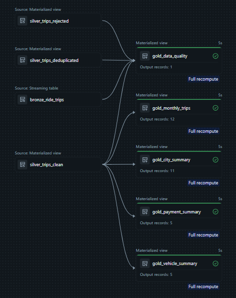

# 🚗 Ride-Hailing Trip Analytics

## 📌 Project Overview

This project focuses on analyzing ride-hailing trip data using **Databricks, SQL, and AI/BI Dashboards** to identify business trends, understand customer booking patterns, and generate meaningful insights.

The project follows the **Medallion Architecture (Bronze, Silver, and Gold)** to transform raw trip data into clean, structured, and business-ready datasets.

## 🎯 Project Objectives

- Analyze ride-hailing trip patterns and trends.
- Identify revenue and booking performance.
- Understand city-wise and time-based trip distribution.
- Clean and validate raw datasets.
- Build interactive dashboards for business insights.
- Use AI-powered Genie to explore data through natural language questions.

## 🛠️ Technologies Used

| Technology | Purpose |
|---|---|
| Databricks | Data processing and analytics |
| SQL | Data transformation and analysis |
| Python | Data processing |
| Unity Catalog | Data governance |
| Delta Lake | Reliable data storage |
| Medallion Architecture | Data pipeline design |
| AI/BI Dashboards | Data visualization |
| Databricks Genie | Natural language data exploration |

## 🏗️ Data Architecture

The project follows the Medallion Architecture.

```text
             RAW DATA
                 |
                 ▼
          BRONZE LAYER
          Raw Data Storage
                 |
                 ▼
          SILVER LAYER
       Data Cleaning & Validation
                 |
                 ▼
           GOLD LAYER
       Business-Ready Data
                 |
                 ▼
        AI/BI DASHBOARDS
                 |
                 ▼
        BUSINESS INSIGHTS
```

### 🥉 Bronze Layer
- Ingested raw ride-hailing data.
- Stored the original dataset for further processing.

### 🥈 Silver Layer
- Cleaned and transformed the raw data.
- Handled missing and duplicate records.
- Performed data validation.

### 🥇 Gold Layer
- Created analytical datasets.
- Prepared business-ready tables.
- Supported dashboard development and analysis.

## 📊 Dashboard

The project includes a four-page interactive dashboard covering:

1. **Executive Overview** – Key performance indicators and overall business performance.
2. **Trip Analysis** – Trip patterns, booking trends, and ride distribution.
3. **Revenue Analysis** – Revenue performance and financial trends.
4. **City Analysis** – City-wise performance and geographical comparisons.

## Dashboard Screenshots

### 1. Executive Overview


### 2. Vehicle and Payment Analysis


### 3. City and Regional Analysis


### 4. Data Quality and Validation


## 🔄 Data Pipeline

The project implements a structured data pipeline using Databricks to process data across Bronze, Silver, and Gold layers.

### Pipeline Architecture


## 💡 Key Learnings

- Understanding the Medallion Architecture.
- Working with Unity Catalog and Delta Lake.
- Performing data cleaning and validation.
- Writing SQL queries for business analysis.
- Building interactive AI/BI dashboards.
- Exploring datasets using Databricks Genie.
- Understanding end-to-end data analytics workflows.

## 📁 Repository Structure

```text
Ride-Hailing-Trip-Analytics/
│
├── SQL/
├── Dashboard_Screenshots/
├── Pipeline_Screenshots/
└── README.md
```

## 👨‍💻 Author

**Maheeshwar Ravula**

Aspiring Data Analyst | Data Analytics Learner

- GitHub: [maheeshwar18](https://github.com/maheeshwar18)
- LinkedIn: [Maheeshwar Ravula](https://www.linkedin.com/in/maheeshwar-ravula/)

---

⭐ If you find this project useful, feel free to explore the repository!
